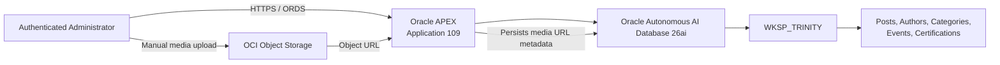
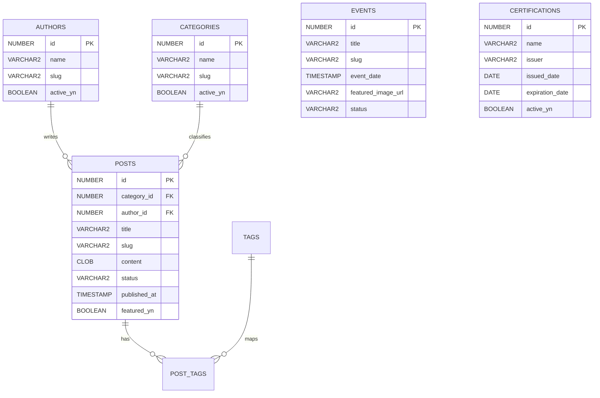

# TRINITY Platform

**Oracle APEX + Oracle Autonomous AI Database 26ai on Oracle Cloud Infrastructure**

TRINITY is a personal engineering platform focused on Oracle technologies, technical publishing, and practical implementation of modern Oracle Database and Oracle APEX capabilities.

The project is developed as a real, version-controlled implementation. Its current engineering baseline combines a relational data model, Oracle APEX administrative content management, Oracle Autonomous AI Database 26ai, OCI Object Storage for selected media assets, automated auditing, source-controlled database migrations, and architecture documentation.

> **Project status:** Active development<br>
> **Current baseline:** Oracle APEX administrative CMS + Autonomous AI Database 26ai + OCI Object Storage media integration<br>
> **Primary purpose:** Professional engineering portfolio, Oracle platform development, and technical publishing

---

## Engineering Snapshot

| Area | Current implementation |
|---|---|
| Cloud platform | Oracle Cloud Infrastructure |
| Region | `mx-monterrey-1` |
| Database | Oracle Autonomous AI Database 26ai |
| Database workload | APEX |
| Application layer | Oracle APEX 26.1.x |
| APEX application | TRINITY Platform |
| Application ID | `109` |
| Parsing schema | `WKSP_TRINITY` |
| Database model | 7 tables |
| Supporting indexes | 4 |
| Audit triggers | 7 |
| APEX pages | 13 |
| Media storage | OCI Object Storage for selected event images |
| Source control | Git + GitHub |

The Oracle APEX export and database artifacts in this repository represent the current source-controlled TRINITY implementation.

---

## Current Architecture



The current application does **not** require a dedicated OCI Compute instance.

OCI Object Storage is currently used as a media repository for selected image assets. TRINITY stores the object URL in the database and Oracle APEX renders the referenced image. Object Storage is not represented as a replacement for the APEX application runtime.

---

## Current Application Scope

The current Oracle APEX application is primarily an authenticated administrative CMS.

```text
TRINITY Platform
│
├── Global Page
├── Home
├── Posts
│   └── Post
├── Categories
│   └── Category
├── Authors
│   └── Author
├── Events
│   └── Event
├── Certifications
│   └── Certification
└── Login Page
```

The public-facing publishing experience remains in progress.

---

## Implemented Capabilities

### Database and data model

- Relational content model created from Oracle Quick SQL.
- Seven core tables: `AUTHORS`, `CATEGORIES`, `POSTS`, `TAGS`, `POST_TAGS`, `EVENTS`, and `CERTIFICATIONS`.
- Identity-generated numeric primary keys.
- Foreign-key relationships for the publishing model.
- Supporting indexes for foreign-key access paths.
- Standard audit columns: `CREATED`, `CREATED_BY`, `UPDATED`, and `UPDATED_BY`.
- Seven automatic audit triggers.
- Native Oracle SQL `BOOLEAN` columns where appropriate.
- Controlled database migrations for changes applied after the original v1 DDL baseline.

### Oracle APEX

- Application 109 — **TRINITY Platform**.
- 13 application pages.
- Administrative CRUD for Posts, Categories, Authors, Events, and Certifications.
- Oracle APEX Accounts authentication.
- Administration authorization scheme.
- Shared Lists of Values for relational selections.
- Dynamic Actions for client-side behavior.
- Automatic slug generation for publishing records.
- Publication lifecycle control for Posts.
- Event lifecycle management.
- Native Boolean handling for Certification active status.
- Credential verification links in the Certifications report.

### Events

The Events module supports title, slug, description, event date, location, external event URL, status, featured image URL, and audit metadata.

Selected event images are stored as objects in OCI Object Storage. The database stores the media URL in:

```text
EVENTS.FEATURED_IMAGE_URL
```

The current column definition is:

```text
VARCHAR2(500)
```

The APEX Events report renders the referenced image from the stored URL.

### Certifications

The Certifications module supports certification name, issuer, credential identifier, credential URL, issue date, expiration date, description, active status, and audit metadata.

The active state uses a native database Boolean:

```text
CERTIFICATIONS.ACTIVE_YN
BOOLEAN
DEFAULT TRUE
NOT NULL
```

Oracle APEX presents the value as:

```text
TRUE  → Yes
FALSE → No
```

The Certifications report exposes the credential URL as a concise **Verify** link instead of displaying the complete URL.

---

## Data Model



`EVENTS` and `CERTIFICATIONS` remain standalone entities in the current relational model.

---

## Database Change Strategy

TRINITY preserves the original generated v1 DDL as a baseline:

```text
database/ddl/TRINITY_V1_SCHEMA.sql
```

Changes applied after that baseline are captured as ordered migrations:

```text
database/migrations/
├── 001_add_event_featured_image.sql
└── 002_certifications_active_default.sql
```

This keeps the original generated artifact intact while making subsequent schema evolution explicit and reviewable.

### Migration 001

Adds:

```text
EVENTS.FEATURED_IMAGE_URL VARCHAR2(500)
```

### Migration 002

Hardens the existing native Oracle SQL Boolean active-state column by normalizing `NULL` values to `TRUE` and enforcing the final default and nullability rules:

```text
BOOLEAN
DEFAULT TRUE
NOT NULL
```

---

## Oracle APEX Source

The source-controlled APEX application export is:

```text
apex/exports/f109.sql
```

Current verified export characteristics:

```text
Application:   109
Name:          TRINITY Platform
Pages:         13
Format:        SQL
Export type:   Standard Export
```

Current verified page additions include:

```text
Page 14 — Events
Page 15 — Event
Page 16 — Certifications
Page 17 — Certification
```

Current controlled export SHA-256:

```text
df3395e3998d8b8117fee4eace859c579902cc69129793ba18dfe4309e4a6fff
```

Oracle-generated APEX exports should be treated as generated source artifacts and should not be manually reformatted.

---

## OCI Object Storage Media Workflow

```text
Image file
   │
   ▼
OCI Object Storage
   │
   ▼
Object URL
   │
   ▼
EVENTS.FEATURED_IMAGE_URL
   │
   ▼
Oracle APEX Events report
   │
   ▼
Rendered image
```

Current boundaries:

- Object Storage is implemented for selected media assets.
- Image upload is currently handled outside the APEX application.
- APEX stores and renders the resulting object URL.
- No dedicated OCI Compute instance is used.
- A custom domain and OCI DNS are not yet part of the deployed baseline.

---

## Repository Structure

```text
Trinity/
├── README.md
├── .gitignore
├── .gitattributes
├── apex/
│   ├── README.md
│   └── exports/
│       └── f109.sql
├── database/
│   ├── README.md
│   ├── ddl/
│   │   └── TRINITY_V1_SCHEMA.sql
│   ├── migrations/
│   │   ├── 001_add_event_featured_image.sql
│   │   └── 002_certifications_active_default.sql
│   └── quicksql/
│       └── trinity-v1.quicksql
├── docs/
│   ├── architecture/
│   │   └── README.md
│   └── decisions/
│       ├── ADR-001-platform-baseline.md
│       └── ADR-002-object-storage-media.md
└── assets/
    └── README.md
```

---

## Current vs. In Progress vs. Planned

### Current

- Oracle Autonomous AI Database 26ai.
- Oracle APEX Application 109.
- Authenticated administrative CMS.
- Posts, Categories, and Authors administration.
- Events administration with featured image URL support.
- Certifications administration with native Boolean active state.
- OCI Object Storage for selected event media.
- Git/GitHub source control.
- Database migrations.
- Architecture documentation and ADRs.

### In progress

- Public-facing publishing experience.
- Public Events and Certifications presentation.
- Expanded deployment documentation.
- Updated architecture visuals reflecting the latest Object Storage media path.
- Additional content-management capabilities.

### Planned

- Public Home.
- Public Blog / Articles.
- Public Events.
- Public Certifications.
- About and Contact experiences.
- Administrative management for Tags.
- More integrated media-management workflow.
- Custom domain.
- OCI DNS.
- Additional security hardening.
- Expanded observability and operational documentation.

Planned capabilities are intentionally separated from implemented functionality.

---

## Engineering Principles

- **Evidence over claims** — current functionality is separated from roadmap items.
- **Database-first integrity** — core data integrity remains owned by Oracle Database.
- **Source control by default** — database, migrations, APEX exports, architecture, and ADRs are version controlled.
- **Traceable evolution** — post-baseline schema changes are captured as ordered migrations.
- **Security by design** — secrets, tokens, private keys, session identifiers, and sensitive account data must not be committed.
- **Minimal operational footprint** — infrastructure is added only when a concrete requirement justifies it.
- **Professional documentation** — repository content should be understandable without undocumented project history.

---

## Security

Do not commit:

- OCI private keys.
- API signing keys.
- Passwords.
- Authentication tokens.
- Active APEX session identifiers.
- Oracle Wallet credentials.
- Private connection credentials.
- Sensitive personal information.
- Screenshots containing confidential account data.

Every public export or release should receive a security review before push.

---

## Roadmap

```text
Relational baseline
        ↓
APEX administrative CMS
        ↓
Events + Certifications
        ↓
OCI Object Storage media integration
        ↓
Source-controlled migrations
        ↓
Public publishing experience
        ↓
Custom-domain and delivery enhancements
        ↓
Operational hardening
```

---

## Author

**Florentino López**

Oracle technology practitioner focused on Oracle Database, Oracle APEX, Autonomous AI Database, Oracle Cloud Infrastructure, data engineering, and practical application architecture.

GitHub: [@tinuslopez](https://github.com/tinuslopez)

---

## Project Notice

TRINITY is an independent personal engineering project.

Oracle, Oracle Database, Oracle APEX, Oracle Cloud Infrastructure, and related product names are trademarks or registered trademarks of Oracle and/or its affiliates. This repository is not an Oracle product and does not represent an official Oracle implementation or endorsement.
