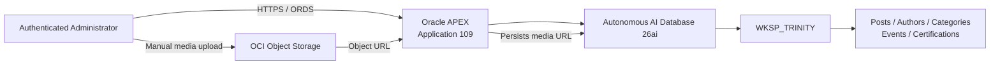
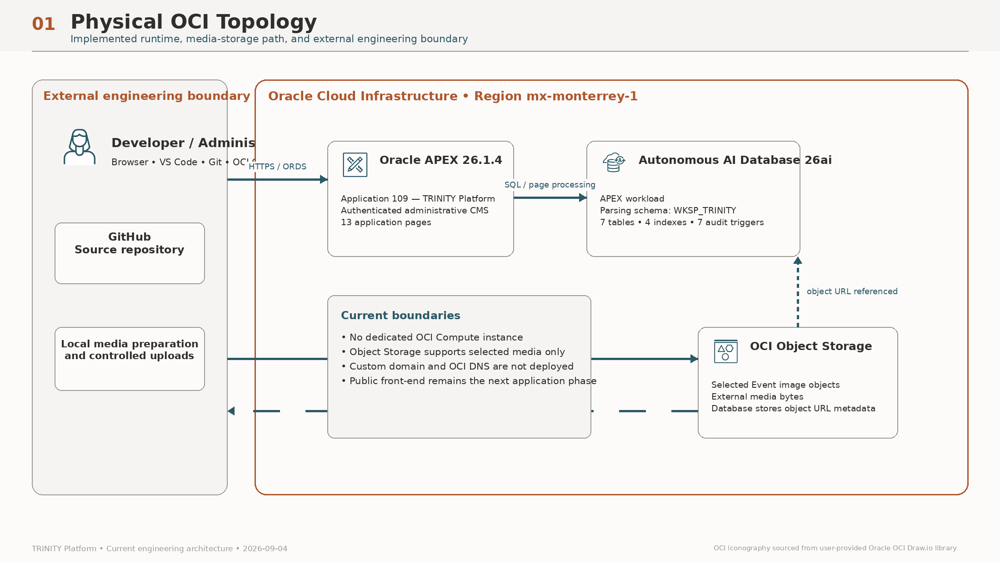
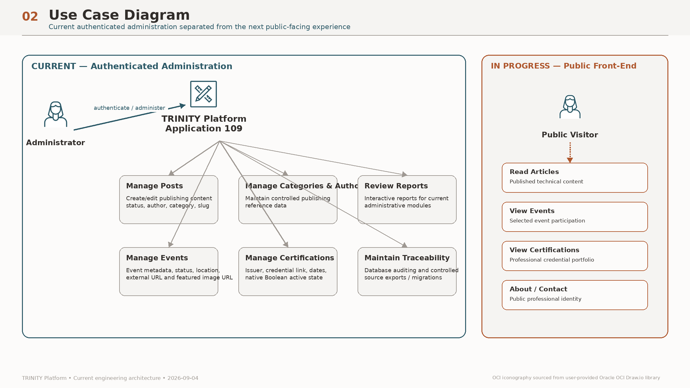
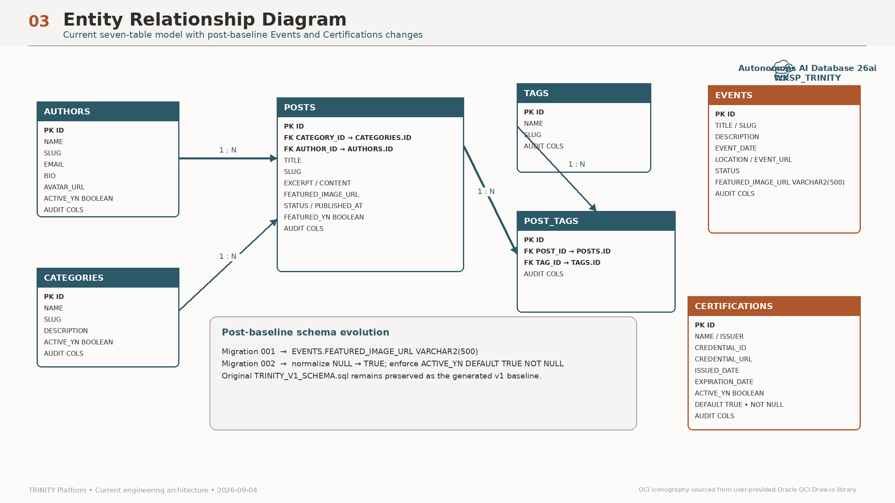
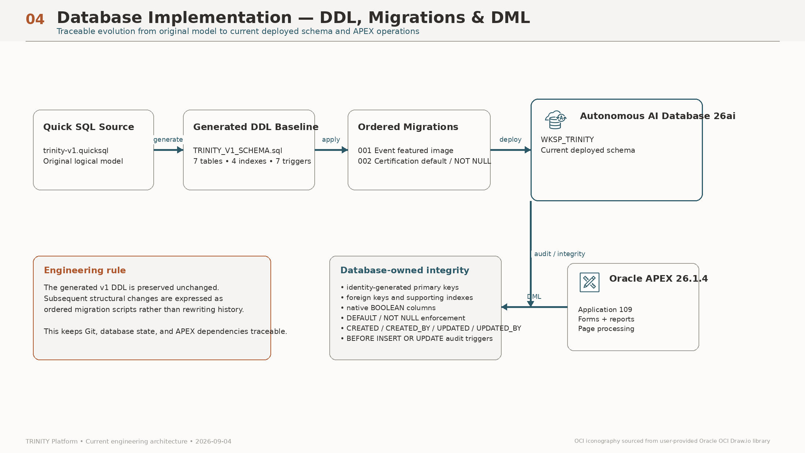
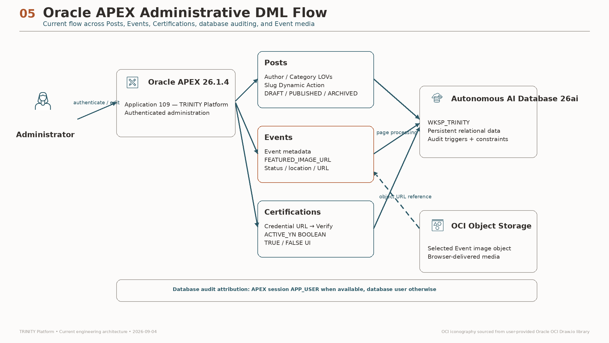
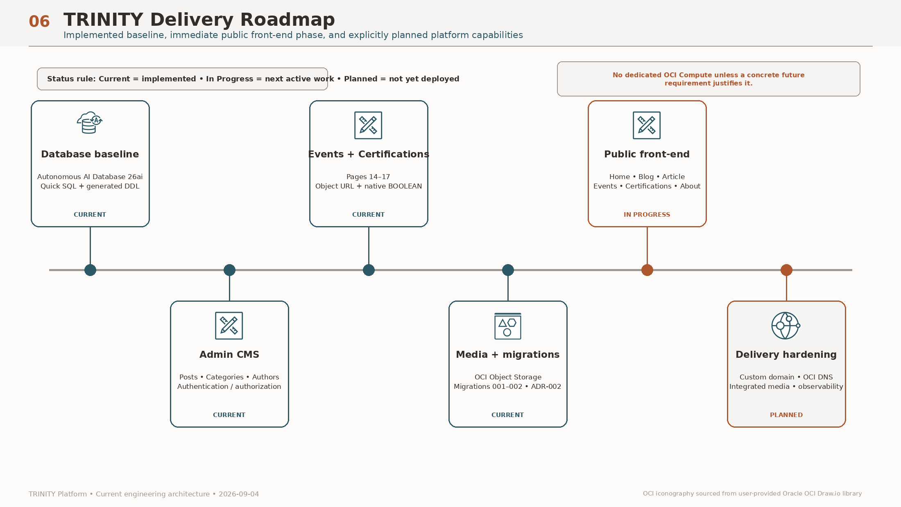

# TRINITY Platform — Architecture

**Architecture documentation for the current TRINITY engineering baseline**

This directory contains the controlled architecture documentation and diagram portfolio for TRINITY Platform.

TRINITY deliberately distinguishes between:

- **Current** — implemented and demonstrable.
- **In progress** — actively being developed.
- **Planned** — future capabilities that must not be interpreted as deployed.

---

## Current Architecture Baseline

The current platform baseline is:

```text
Oracle Cloud Infrastructure
Region: mx-monterrey-1
│
├── Oracle Autonomous AI Database 26ai
│   └── APEX workload
│       └── Oracle APEX
│           └── Application 109 — TRINITY Platform
│               └── Parsing Schema — WKSP_TRINITY
│
└── OCI Object Storage
    └── Selected media objects for TRINITY event images
```

A dedicated OCI Compute instance is not required for the current implementation.

---

## Current Logical Architecture



The Object Storage integration is intentionally narrow:

- Media files are stored in OCI Object Storage.
- TRINITY stores the object URL as relational metadata.
- Oracle APEX renders the referenced media.
- Object upload is currently handled outside the APEX application.
- Object Storage is not the Oracle APEX application runtime.

---

## Administrative Application Scope

The implemented Oracle APEX scope now includes:

```text
Global Page
Home
Posts
Post
Categories
Category
Authors
Author
Events
Event
Certifications
Certification
Login Page
```

The application currently contains 13 pages.

The public-facing publishing experience remains in progress.

---

## Database Scope

The current relational model contains:

```text
AUTHORS
CATEGORIES
POSTS
TAGS
POST_TAGS
EVENTS
CERTIFICATIONS
```

Core relationships:

```text
AUTHORS       1 ───────────< POSTS
CATEGORIES    1 ───────────< POSTS
POSTS         1 ───────< POST_TAGS >─────── 1 TAGS
```

`EVENTS` and `CERTIFICATIONS` remain standalone entities.

The original physical baseline includes:

```text
7 tables
4 supporting indexes
7 audit triggers
```

Post-baseline schema evolution is captured through:

```text
database/migrations/
```

---

## Implemented Architecture Extension — OCI Object Storage

OCI Object Storage is now an implemented supporting service for selected TRINITY media assets.

Current media path:

```text
Media file
    │
    ▼
OCI Object Storage
    │
    ▼
Object URL
    │
    ▼
EVENTS.FEATURED_IMAGE_URL
    │
    ▼
Oracle APEX Events report
```

This extension does not change the decision to avoid a dedicated OCI Compute instance.

The media-storage decision is documented separately in:

```text
docs/decisions/ADR-002-object-storage-media.md
```

---

## Diagram Portfolio

### 01 — Physical OCI Topology



**File:** `01-physical-oci-topology-trinity-v1.png`

Documents the current physical topology centered on Oracle Cloud Infrastructure, region `mx-monterrey-1`, Oracle Autonomous AI Database 26ai, Oracle APEX 26.1.4, Application 109, parsing schema `WKSP_TRINITY`, and OCI Object Storage for selected Event media.

The diagram also keeps the external engineering boundary visible and explicitly states that dedicated OCI Compute, a custom domain, and OCI DNS are not part of the deployed runtime.

### 02 — Use Case Diagram



**File:** `02-use-case-diagram-trinity.png`

Separates the current authenticated administrative use cases from the public-facing experience that is now the next active phase.

The current administration includes Posts, Categories, Authors, Events, Certifications, reporting, and engineering traceability. Public article, event, certification, About, and Contact experiences remain in progress.

### 03 — Entity Relationship Diagram



**File:** `03-erd-trinity-v1-schema.png`

Documents the current seven-table relational model while preserving the distinction between the original generated v1 DDL and post-baseline migrations. Current column-level changes include:

```text
EVENTS.FEATURED_IMAGE_URL
CERTIFICATIONS.ACTIVE_YN native BOOLEAN
```

### 04 — Database Implementation: DDL and DML



**File:** `04-database-implementation-ddl-dml.png`

Documents the traceable implementation chain from Quick SQL to the generated DDL baseline, ordered migrations, the current Autonomous AI Database schema, and Oracle APEX DML.

The current database engineering model preserves the original generated DDL and applies later structural evolution through migrations.

### 05 — Oracle APEX DML Publishing Flow



**File:** `05-apex-dml-publishing-flow.png`

Documents the current APEX-to-database administrative flow across Posts, Events, and Certifications, including native Boolean handling, credential verification links, database auditing, and the Event media reference path through OCI Object Storage.

The core database-persistence pattern remains:

```text
Administrator
      │
      ▼
Oracle APEX Form
      │
      ▼
APEX Page Processing
      │
      ▼
Oracle Database
      │
      ▼
Audit Trigger
```

### 06 — TRINITY Delivery Roadmap



**File:** `06-delivery-roadmap-trinity.png`

Documents the implemented milestones, the public front-end as the next active phase, and explicitly planned delivery capabilities such as custom domain, OCI DNS, integrated media management, observability, and operational hardening.

Roadmap elements are visually separated by Current, In Progress, and Planned status.

---

## Architecture Views

| Diagram | View | Primary question |
|---|---|---|
| 01 Physical OCI Topology | Physical / deployment | Where does the original v1 runtime execute? |
| 02 Use Case Diagram | Functional | Who interacts with TRINITY and how? |
| 03 ERD | Data | How is TRINITY data structured? |
| 04 Database Implementation | Database engineering | How is the data model physically implemented and evolved? |
| 05 APEX Publishing Flow | Application / data flow | How does APEX persist administrative data? |
| 06 Delivery Roadmap | Evolution | How does TRINITY progress beyond the current baseline? |

---

## Application Responsibilities

Oracle APEX currently owns:

- Authentication.
- Authorization.
- Navigation.
- Interactive reports.
- Forms.
- Shared LOVs.
- Page validations.
- Dynamic Actions.
- Page processing.
- Publication-state selection.
- Boolean presentation.
- Client-side slug generation.
- Event image URL presentation.
- Credential verification links.

---

## Database Responsibilities

Oracle Autonomous AI Database currently owns:

- Persistent relational storage.
- Primary keys.
- Foreign keys.
- Identity-generated identifiers.
- Supporting indexes.
- Native Boolean columns.
- Column defaults.
- `NOT NULL` rules.
- Audit columns.
- Audit triggers.
- Relational integrity.

The parsing schema is:

```text
WKSP_TRINITY
```

The original DDL artifact is:

```text
database/ddl/TRINITY_V1_SCHEMA.sql
```

Post-baseline changes are under:

```text
database/migrations/
```

---

## Object Storage Responsibilities

OCI Object Storage currently owns:

- Storage of selected image files used by TRINITY.
- Delivery of those media objects through their object URLs.

TRINITY currently owns:

- The media URL metadata.
- Association of an image URL with an Event record.
- Rendering the referenced image in Oracle APEX.

TRINITY does **not** currently implement an integrated APEX-to-Object-Storage upload workflow.

---

## Source-Control Traceability

```text
Quick SQL
    │
    ▼
Original DDL baseline
    │
    ▼
Ordered migrations
    │
    ▼
Autonomous AI Database 26ai
    │
    ▼
Oracle APEX Application 109
    │
    ▼
Standard APEX Export
    │
    ▼
Git
    │
    ▼
GitHub
```

Relevant source paths:

```text
database/quicksql/trinity-v1.quicksql
database/ddl/TRINITY_V1_SCHEMA.sql
database/migrations/
apex/exports/f109.sql
```

---

## Architecture Decision Records

### ADR-001

```text
docs/decisions/ADR-001-platform-baseline.md
```

Defines the original APEX + Autonomous AI Database baseline and the decision not to introduce dedicated OCI Compute without a concrete requirement.

### ADR-002

```text
docs/decisions/ADR-002-object-storage-media.md
```

Documents the addition of OCI Object Storage for selected media assets while preserving the original managed APEX runtime baseline.

---

## Current vs. In Progress vs. Planned

### Current

```text
OCI
├── Autonomous AI Database 26ai
│   └── Oracle APEX
│       └── Application 109
│           ├── Posts / Post
│           ├── Categories / Category
│           ├── Authors / Author
│           ├── Events / Event
│           ├── Certifications / Certification
│           └── WKSP_TRINITY
│
└── Object Storage
    └── Selected event media objects
```

### In progress

```text
Public publishing experience
Public Events / Certifications presentation
Expanded deployment documentation
Additional content-management capabilities
```

### Planned

```text
Custom domain
OCI DNS
Tag administration
Integrated media upload workflow
Expanded observability
Operational hardening
Potential independent services only if justified
```

---

## OCI Iconography

The refreshed diagrams use Oracle OCI service iconography sourced from the project's Draw.io OCI architecture library. Relevant current and planned service icons include:

```text
Developer Services - APEX
Database - Autonomous DB
Storage - Object Storage
Identity and Security - User
Networking - DNS
```

Icons retain their proportions and are not rotated, skewed, shadowed, or recolored outside the restrained Oracle-oriented palette used by the architecture portfolio. The complete source icon library is not redistributed in this repository.

---

## Architecture Governance

Before architecture documentation is changed, verify that:

1. Every Current-state component actually exists.
2. Planned components are explicitly identified as planned.
3. `WKSP_TRINITY` is identified as the parsing schema.
4. `TRINITY_V1_SCHEMA.sql` is identified as a SQL artifact, not as the schema owner.
5. Object Storage is represented only for implemented media usage.
6. No dedicated OCI Compute instance is shown unless actually deployed.
7. APEX responsibilities are not confused with database responsibilities.
8. Database migrations are represented as post-baseline evolution.
9. Sensitive information such as OCIDs, credentials, tokens, private URLs, and active sessions is absent.
10. Diagrams remain readable and consistent with repository source and ADRs.

---

## Review Audience

The architecture portfolio is intended to be understandable by Oracle technology professionals, database professionals, Oracle APEX developers, solution architects, technical hiring managers, and future collaborators.

The goal is to make the engineering **clear, traceable, accurate, and professionally presented**.
